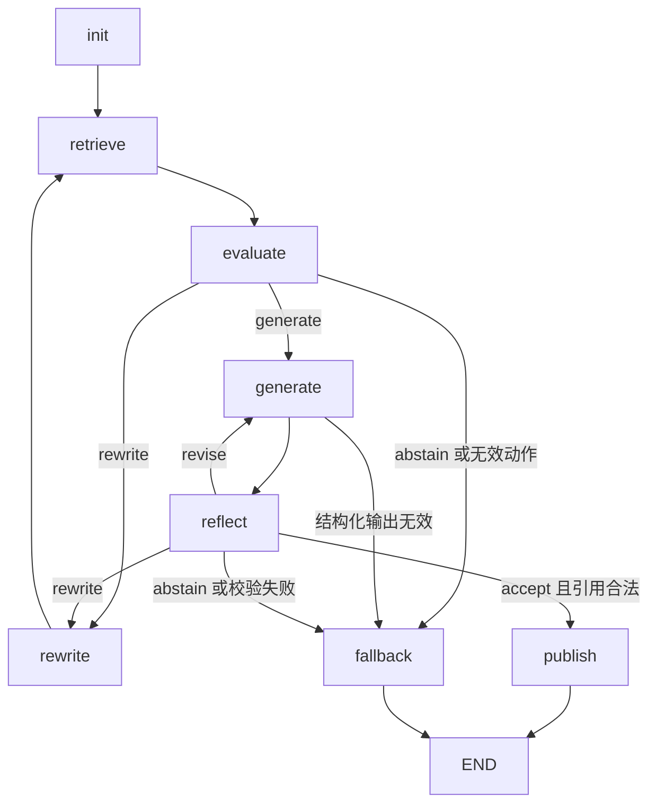

# 在线 Agentic RAG

只升级咨询子图，复用原有混合检索、模型客户端、Checkpoint 和 SSE。
离线咨询、有限规则导诊、预约确认和 MCP 业务工具继续使用原路径。

## 模型决策

`Brain.review()` 使用现有 `structured()`，将 `RagReview` 作为 function calling schema。
输出字段是 `action`、`reason`、`next_query` 和 `feedback`。

- 证据评估允许 generate、rewrite、abstain。
- 答案自查允许 accept、revise、rewrite、abstain。
- rewrite 必须提供非空、没有执行过的新查询。
- revise 必须提供具体修改反馈；生成调用同时收到前一版草稿。
- accept 仍受非空答案、非空引用、引用 ID 必须来自证据的代码检查约束。

原始问题始终固定，改写只改变检索问题。已有指代消解在 init 中执行。
提示词要求不增加用户未表达的事实，并把证据、草稿和历史反馈视为数据。
同一模型生成并评审，可能重复自身错误；接受结果不等于医学或事实准确性证明。

## 状态与预算

`AgentState.rag` 保存原问题、当前查询、查询历史、计数、候选答案与引用、反馈及评审记录。
咨询入口初始化这些字段；新一轮非咨询请求也清空 RAG 状态，避免旧状态混入响应。
循环状态由父图的 Checkpoint Saver 持久化，无须新增数据库表。

预算在 `consultation.py` 的 `LIMITS` 中定义：

| 类型 | 上限 |
|---|---:|
| 检索，包含首次 | 3 |
| 循环改写，不含入口指代消解 | 2 |
| 答案生成，包含首次 | 3 |

模型可提前接受或退出。达到上限时走 fallback，不发布未通过检查的草稿。
现有图总步数限制为 30，测试覆盖三次检索、三次生成的最长循环路径。
修改预算时必须重新核对总步数限制和证据规模。

每轮检索继续调用 `Retriever.search()`：BM25 + embedding 余弦相似度 + RRF。
检索分数门控保持原有实现，多轮结果按文档 ID 去重；默认最多累积九个片段。
没有新增 reranker，也不把不同查询的 RRF 分数当作全局排名。

## API 和界面

`/api/chat`、SSE 的最终 result 和 `/api/threads/{id}` 返回公开 `rag` 信息：
问题、查询历史、计数、status、stop_reason 和 reviews。
公开 reviews 只包含 phase、action、next_node；模型 reason / feedback 可能复述未通过的草稿，
因此只保存在内部 Checkpoint，不进入公开响应。自查修订反馈跨重检索和证据评估保留，
避免新的评估理由覆盖原来的纠错要求。
draft_answer 和 draft_citation_ids 只在内部状态中使用，不通过上述 API 返回。
用户可在前端执行轨迹中看到 evaluate、rewrite、generate、reflect、publish、fallback 阶段。
阶段事件不包含候选答案。

`status` 为 running、accepted 或 abstained。
`stop_reason` 区分预算耗尽、重复查询、无证据、非法动作、无效引用和模型输出解析失败。
传输异常仍由现有 API 错误路径处理；不进行额外自主网络重试。

## 验证范围

`tests/test_agentic_rag.py` 使用真实 Service、LangGraph、SQLite Checkpoint、请求缓存和模型解析。
模型网络响应及检索结果为可控替身，覆盖自主路由、反馈修订、证据去重、预算、引用防护、
非法输出、新问题重置、重启读取以及真实 API/SSE 调用。
替身验证工程行为，不能替代真实在线模型的效果评测。
